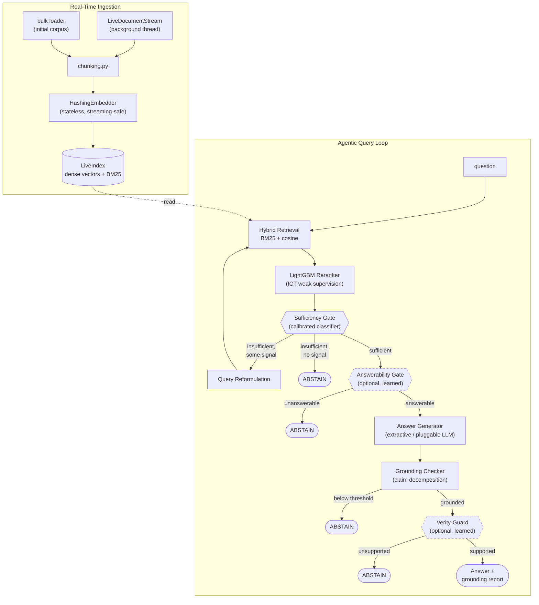

[](https://github.com/mugil0095/Verity-RAG/actions/workflows/ci.yml)
[](https://github.com/mugil0095/Verity-RAG/blob/master/LICENSE)
[](https://www.python.org/downloads/release/python-3120/)

# VerityRAG 

**Real-time agentic RAG with grounding & hallucination detection.** [Live Link](https://verityrag.streamlit.app/)

VerityRAG ingests documents continuously (no offline reindex step), answers
questions through a bounded multi-hop retrieval agent, and refuses to answer
rather than hallucinate when it doesn't have grounded evidence.

```
Coverage on real answerable questions:        93.3%
Correctly abstained on held-out-topic Qs:      77.3%   (the hallucination guard)
Query latency:                                 p50 ~58ms / p95 ~88ms
```
Full numbers in [`eval_report.json`](eval_report.json), reproducible with `python -m verityrag.eval`.

## Why this project

Three things RAG teams are actually hiring for: **agentic** multi-step
retrieval, **grounding/hallucination mitigation**, and **RAG evaluation
tooling**. This is a working implementation of all three, with tests.

## Architecture



| Layer | File | What it does |
|---|---|---|
| Chunking | `chunking.py` | Sentence-aligned, overlapping chunks |
| Embedding | `embedding.py` | Stateless hashed bag-of-n-grams (default) or a real encoder (opt-in) |
| Indexing | `indexing.py`, `elasticsearch_index.py` | Thread-safe incremental dense + BM25 index (pluggable Elasticsearch backend) |
| Retrieval | `retrieval.py` | Hybrid lexical + dense search |
| Reranking | `reranker.py` | LightGBM `LGBMRanker`, ICT weak supervision |
| Sufficiency | `sufficiency.py` | Calibrated classifier: enough evidence to try? |
| Agent | `agent.py`, `agent_reformulate.py` | Bounded retrieve/reformulate/generate/ground/abstain loop |
| Generation | `generation.py`, `llm_providers.py` | Extractive default + pluggable real-LLM generators |
| Grounding | `grounding.py` | Claim decomposition + evidence matching |
| Streaming | `streaming.py` | Background real-time ingestion |
| Serving | `api.py`, `app.py` | FastAPI backend, Streamlit frontend |
| Eval | `eval.py` | Full-corpus evaluation harness |
| Guard (optional) | `guard/` | Learned hallucination detector + answerability gate (ONNX int8), off by default; see [Verity-Guard](#verity-guard-learned-hallucination-detector) |
| MCP server (optional) | `mcp_server.py` | Exposes ingest / answer / verify_claim as MCP tools (`python -m verityrag.mcp_server`) |

## Evaluation data

Built from the real **SQuAD 1.1 dev set** — real Wikipedia paragraphs and
real questions, not synthetic text:

- **620 documents / 845 chunks** across 12 topics
- **150 answerable questions** from that corpus
- **150 questions from 36 topics never ingested** — tests whether the
  system hallucinates on things it doesn't know

Calibration and test questions are kept strictly disjoint (50/50 split,
fixed seed) so reported numbers aren't measuring data the classifier was
fit on.

## Design decisions (and the bugs behind them)

Full detail on any of these — including exact numbers, root causes, and
the diagnostic process — is in [ROADMAP.md](ROADMAP.md). Summarized here:

- **No pretrained embedding model by default.** `HashingEmbedder` is a
  stateless hashed bag-of-n-grams transform — a real advantage for
  real-time ingestion, but stopwords swamped the topical signal until
  filtering was added. `SentenceTransformerEmbedder` is an opt-in swap
  behind the same interface (see "Real embeddings, measured").
- **The lexical tokenizer didn't strip punctuation.** Found by comparing
  against Elasticsearch: `rank_bm25`'s tokenizer was pure whitespace
  splitting, so `"Tesla,"` and `"Tesla"` never matched. Fixed to a proper
  regex tokenizer. Real trade-off: guard improved (73.3%→77.3%) but
  coverage dropped slightly (96%→93.3%) — some of the old bug's
  punctuation-attached matches were accidentally helping a few questions
  pass the sufficiency gate.
- **A single relevance threshold doesn't separate answerable from
  unanswerable questions** — their score distributions heavily overlap.
  Fixed with a small LightGBM classifier (`sufficiency.py`) trained on
  multiple retrieval features instead.
- **Query reformulation was amplifying hallucination risk.** The retry
  logic assumed the first pass found something relevant to refine; for
  genuinely out-of-domain questions it pulled the search toward a wrong
  match instead of away. Guard was 9.3% with unconditional reformulation,
  77.3% once gated on the sufficiency classifier's own confidence.
- **Bulk ingestion was accidentally O(n²)** — `rank_bm25` has no
  incremental update API, so adding documents one at a time rebuilt the
  entire lexical index every call (61s for the initial corpus). Bulk
  loading now chunks everything first and rebuilds once: 61s → 2.7s.
  True streaming ingestion still rebuilds per document by design
  (~430ms/doc) — Elasticsearch is the production fix (see below).
- **Real embeddings crashed on Windows, twice** — a `STATUS_ACCESS_VIOLATION`
  from conflicting OpenMP runtimes (PyTorch + MKL-linked scikit-learn/
  LightGBM), fixed at load time; a second crash from thread-pool
  contention under sustained use, fixed with `OMP_NUM_THREADS=1`. Both
  real fixes, but forcing single-threaded execution is part of why real
  embeddings pay a latency tax. A later, real ~15% latency improvement
  (`MKL_THREADING_LAYER=GNU`) is available as an opt-in but not the
  default — the crash it works around needed sustained use to surface,
  and this alternative has less runtime behind it so far.
- **Concurrency was designed in but never actually load-tested** —
  `LiveIndex` uses `threading.RLock()` around reads and writes so
  ingestion and queries can happen at once, reasoned about but not
  verified until `scripts/concurrent_load_check.py` fired genuine
  concurrent HTTP traffic at a real running server: zero errors across
  160+ concurrent ingest/query calls. Holds up because `VectorIndex.add()`
  builds a brand-new array (`np.vstack`) rather than mutating one in
  place, so a reader's snapshot stays valid through a concurrent write.

## Real embeddings, measured

`SentenceTransformerEmbedder` (`all-MiniLM-L6-v2`) is opt-in via
`python -m verityrag.eval --real-embeddings`:

| Metric | HashingEmbedder (default) | SentenceTransformerEmbedder |
|---|---|---|
| Coverage | 93.3% | 92% |
| Hallucination guard | 77.3% | **96%** |
| Keyword hit rate | 67.1% | 76.8% |
| Avg grounding score | 1.0 | 1.0 |
| Latency, p50 | ~58ms | ~2,175ms |

The tokenizer fix above hit this path much harder (guard 82.7%→96% here,
vs. 73.3%→77.3% for the default) because the real-embeddings-trained
sufficiency classifier relies on lexical score as its single most
important feature. Latency is why this isn't the default — real-time
positioning doesn't currently justify the cost. Swap it in explicitly
where the trade-off is worth it.

## Real LLM generation

`ExtractiveGenerator` (default) stitches sentences straight from
evidence — grounded by construction. `LLMGenerator` calls a real model
instead:

```python
from verityrag.pipeline import VerityRAGPipeline
from verityrag.generation import LLMGenerator
from verityrag.llm_providers import gemini_complete_fn  # or anthropic_complete_fn

pipeline = VerityRAGPipeline(generator=LLMGenerator(complete_fn=gemini_complete_fn))
```

| | `anthropic_complete_fn` | `gemini_complete_fn` |
|---|---|---|
| Setup | `pip install anthropic`, `ANTHROPIC_API_KEY` | `pip install google-genai`, `GEMINI_API_KEY` |
| Cost | Small starter credit, then pay-per-token | Genuine free tier, no card needed |
| Default model | `claude-sonnet-5` | `gemini-3.6-flash` |

Confirmed working end-to-end against the live Gemini API. First
small-sample run (n=8+8): hallucination guard **100%**, coverage 50% —
traced directly to a genuine retrieval gap (the gold-answer chunk
genuinely wasn't in the top-6), not an LLM or grounding-checker problem.
The free tier's daily quota is real and restrictive (~20 requests/day),
so `--max-test-questions N` caps how many questions actually get sent,
for an honest partial measurement (`partial_sample` field in the report)
instead of an infeasible full run:

```
python -m verityrag.eval --real-llm gemini --max-test-questions 8
```

Also live in the deployed app: check "Also show a real LLM's answer" on
the Ask tab to see both generators answer the same question side by
side, off the exact same retrieved evidence.

## Swapping in Elasticsearch

`LexicalIndex` (the `rank_bm25`-based default) has no incremental
indexing API — adding one document rebuilds the *entire* lexical index.
`ElasticsearchLexicalIndex` is a drop-in swap with genuine incremental
indexing:

```python
from verityrag.pipeline import VerityRAGPipeline
from verityrag.elasticsearch_index import ElasticsearchLexicalIndex

pipeline = VerityRAGPipeline(lexical_index=ElasticsearchLexicalIndex())
```

Needs `pip install elasticsearch` and a running instance (not bundled —
for local dev, disable security in `elasticsearch.yml` and cap the JVM
heap explicitly rather than trusting auto-sizing).

Measured against a real running instance, not mocks: comparing it
against `rank_bm25` is what surfaced the tokenizer bug above. At this
project's actual corpus size (845 chunks), Elasticsearch is not faster —
206.0ms/doc (`rank_bm25`) vs. 221.7ms/doc (Elasticsearch) — its fixed
per-call overhead (network round-trip + explicit refresh) exceeds
`rank_bm25`'s rebuild cost at this scale. The architectural principle
still holds for a larger corpus; this one hasn't reached the crossover
point yet, reported honestly rather than only measured at a scale picked
to make the swap look good.

## Known limitations

Tracked as an actual backlog in [ROADMAP.md](ROADMAP.md).

- **Extractive generation by default** trades fluent prose for a
  structural guarantee against hallucination — `LLMGenerator` swaps this
  for a real model when you want it.
- **77.3% hallucination-guard rate by default, not 100%** — reported
  honestly. The optional answerability gate raises it to 93.3% at the
  cost of some coverage (see [Verity-Guard](#answerability-gate-fixes-the-real-failure---answerability)). A real embedder closes part of this gap at a real latency
  cost (see above).
- **Streaming throughput** is bounded by the BM25 rebuild cost described
  above — fine for a trickle of documents, not bulk-loading thousands live.
- **The live demo's LLM comparison feature shares one Gemini API key
  across every visitor** — the free tier's daily quota is shared too,
  not per-visitor. Handled gracefully (a clear error on the LLM side,
  extractive answer still works) rather than crashing, but it's a real,
  known constraint of a free-tier key on a public app.

## Running it

```bash
pip install -r requirements.txt
pip install -e .

python data/build_corpus.py       # rebuild the real eval corpus (SQuAD)
pytest tests/ -v                  # run the test suite
python -m verityrag.eval          # full evaluation
python scripts/demo_streaming.py  # narrated real-time + hallucination-guard demo
uvicorn verityrag.api:app --reload
streamlit run app.py              # recommended for demoing
```

### Streamlit frontend

Two tabs: **Ask a question** (load the corpus, calibrate, ask anything —
see the answer, grounding score, and agent trace; optionally, if a
`GEMINI_API_KEY` is configured, compare the extractive and LLM
generators side-by-side) and **Real-time streaming demo** (watch a
question get refused, documents stream in live, the same question get
answered, and a genuinely out-of-domain question stay correctly
refused). Covered by its own `AppTest`-based test suite.

### Minimal usage

```python
from verityrag import VerityRAGPipeline

pipeline = VerityRAGPipeline()
pipeline.ingest_document("d1", "Steam Engine", "The steam engine converts heat into mechanical work...")
pipeline.train_reranker()

result = pipeline.query("How does a steam engine work?")
print(result.answer, result.grounding.overall_score, result.abstained)
```

## Verity-Guard: learned hallucination detector

A 22M-parameter NLI cross-encoder (`cross-encoder/nli-deberta-v3-xsmall`) fine-tuned to score whether an answer is supported by its evidence. Trained 1 epoch on 10k examples (RAGTruth train + HaluEval QA, with sentence-style augmentation) on a GTX 1650 in ~35 min; evidence is trimmed to the sentences most relevant to the answer (`guard/ctx.py`). Evaluated on 3,700 held-out examples (RAGTruth official test + 20% of HaluEval questions), threshold chosen on validation. Latency = model call only, batch size 1.

| Method | AUROC | F1 | Precision | Recall | ECE | RAGTruth F1 | HaluEval F1 | p50 ms | p95 ms |
|---|---|---|---|---|---|---|---|---|---|
| Heuristic grounding (original) | 0.635 | 0.572 | 0.490 | 0.688 | 0.200 | 0.609 | 0.445 | - | - |
| Verity-Guard, int8 ONNX, CPU (4 threads) | 0.891 | 0.765 | 0.834 | 0.707 | 0.052 | 0.644 | 0.967 | 276.6 | 376.2 |
| Verity-Guard, fp16, GPU (NVIDIA GeForce GTX 1650) | 0.898 | 0.773 | 0.791 | 0.756 | 0.061 | - | - | 77.9 | 84.2 |

GPU batched throughput (batch 32): 20.0 answers/s. int8 model: 87.1 MB.

**Fluent-sentence probe** (full-sentence answers, like the extractive generator's, built from held-out contexts; 463 cases): 0% of supported answers wrongly flagged, 99.2% of unsupported answers caught. This probe is built the same way as part of the training augmentation, so treat it as a regression check, not an independent benchmark.

**Reading these numbers honestly**
- AUROC 0.635 -> 0.89 and calibration (ECE) 0.20 -> 0.05 versus the original heuristic checker.
- HaluEval is mostly synthetic, easy hallucinations; RAGTruth (real LLM outputs, subtle errors) is the meaningful benchmark: F1 0.61 -> 0.64.
- The first model learned a shortcut (short answers = correct, fluent sentences = hallucinated). It was found by hand-testing and fixed with augmentation (`scripts/guard_train.py`); one true paraphrase is still wrongly flagged in manual checks.
- Not yet tested on other domains. Wired into the agent and evaluated end to end on SQuAD below (including a negative result with a real LLM generator).
- Reproduce: `scripts/guard_data.py`, `guard_baseline.py`, `guard_train.py`, `guard_export_onnx.py`, `guard_bench_live.py`, `guard_bench_gpu.py`, `guard_probe.py`. Serve via `verityrag.guard.LearnedGuard` or `python -m verityrag.mcp_server`.

### Setup for the guard (optional)

The guard and answerability gate are optional and off by default; the base pipeline needs none of this.

- Extra dependencies: `pip install onnxruntime transformers` (plus `mcp` for the MCP server; `torch`, `datasets` only to retrain).
- The trained model files are **not in this repo** (they are git-ignored under `guard_work/`). Rebuild them with the scripts in the order `guard_data.py` -> `guard_train.py` -> `guard_export_onnx.py` (guard) and `answer_data.py` -> `answer_train.py` (answerability), or point `VERITY_GUARD_DIR` / `VERITY_ANSWER_DIR` at existing model folders. Without them, `--guard` / `--answerability` fail at startup because the model files are missing.
- Evaluate: `python -m verityrag.eval --guard` and `python -m verityrag.eval --answerability --answerability-threshold 0.90`.

### Wiring the guard into the agent (`--guard`)

`AgentController(answer_guard=LearnedGuard())` also scores each generated answer and abstains if it is judged unsupported (`abstain_reason="guard"`). SQuAD eval, same run, 75 answerable + 75 unanswerable test questions:

| | Coverage | Wrong answers among attempted | Guard rate (unanswerable) | p50 latency |
|---|---|---|---|---|
| Without guard | 0.933 | 23 / 70 | 0.773 | 54 ms |
| With guard | 0.933 | 23 / 70 | 0.773 | 311 ms |

**Result: no change in accuracy, 6x slower.** With the default extractive generator every answer is a sentence copied from the evidence, so it is always "supported" and the guard never fires. The remaining errors are not unsupported claims but answers that do not address the question (retrieved, supported, irrelevant). The guard verifies support, not answerability. The next model to build is a question-answerability classifier (e.g. trained on SQuAD 2.0); the guard is most useful with an LLM generator, which can fabricate. Not yet tested with an LLM generator.

### Answerability gate: fixes the real failure (`--answerability`)

A second small model (same cross-encoder, trained on SQuAD 2.0 train, 12k examples, ~20 min on a GTX 1650) predicts whether the retrieved evidence can answer the question, and the agent abstains before generating if not (`abstain_reason="answerability"`). On SQuAD 2.0 validation (2,375 examples, articles disjoint from training): AUROC 0.948, F1 0.877; flags 100% of unrelated-evidence cases, 73% of adversarial unanswerable questions, and wrongly flags 10% of answerable ones.

Verity-RAG SQuAD eval (75 answerable + 75 unanswerable), threshold sweep, same run each:

| Answerability threshold | Coverage | Abstains on unanswerable | Correct answers | Wrong answers |
|---|---|---|---|---|
| off (baseline) | 0.933 | 0.773 | 47 | 23 |
| 0.39 (F1-tuned on SQuAD 2.0) | 0.613 | 0.960 | 32 | 14 |
| 0.65 | 0.680 | 0.947 | 35 | 16 |
| **0.90** | **0.853** | **0.933** | **44** | **20** |
| 0.98 | 0.907 | 0.893 | 46 | 22 |

At 0.90 the system abstains correctly on 16 points more unanswerable questions (77% -> 93%) while giving up 8 points of coverage and 3 correct answers. Latency p50 rises from ~54 ms to ~190 ms (CPU, int8). Caveats: the 0.90 threshold was picked by looking at this eval (no separate held-out set for it), so the gain is likely somewhat optimistic; the eval set is small (150 questions); and the 20 remaining wrong answers are mostly retrieved-but-not-the-right-sentence errors, which a different model does not fix.

### Learned guard with a real LLM generator: negative result

Same SQuAD eval, but the generator is a real local LLM (Qwen2.5-0.5B-Instruct, GPU, no API key) so the guard sees genuine generations. 150 questions; "wrong" = gold answer string missing (a crude proxy that also counts correct paraphrases as wrong).

| Config | Answered | Correct | Wrong | Abstains on unanswerable |
|---|---|---|---|---|
| LLM + heuristic grounding (baseline) | 58 | 42 | 16 | 90.7% |
| + learned guard (default threshold) | 33 | 23 | 10 | 93.3% |
| + guard + answerability (0.90) | 32 | 23 | 9 | 96.0% |

The learned guard removes 19 correct answers to catch 6 wrong ones. Sweeping its threshold on the recorded scores does not rescue it: on the 58 answered questions its score separates "gold string missing" from "present" with AUROC 0.53, i.e. little better than chance on this distribution. It flags correct, fluent answers (e.g. "In July 1888, Tesla's motor and transformer designs were licensed to Westinghouse." scored 0.994) while also flagging some real problems (an answer that cites 565 °C for "what speed"). Likely cause: the guard was trained on 10k RAGTruth/HaluEval examples whose style differs from short LLM answers over retrieved SQuAD chunks. **Status: keep it experimental and off by default; the answerability gate is the part that helps.** A fix needs training data from this distribution (LLM answers over retrieved evidence with support labels).

## License

MIT — see [LICENSE](LICENSE).
